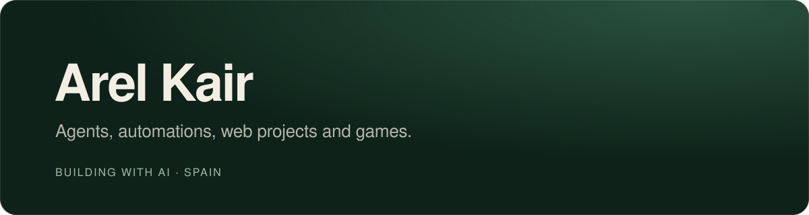

  

I build with AI: agents, automations, web projects, and games. Currently porting Wii Party to PC and shipping small, private-by-default web apps.

## Featured

<table>
  <tr>
    <td width="50%" valign="top">
      <h3><a href="https://github.com/arelkair/wiiparty-recomp">Wii Party Recomp</a></h3>
      Static recompilation of Wii Party, running natively on PC with no emulator.  
      C++
    </td>
    <td width="50%" valign="top">
      <h3><a href="https://nivra.arelkair.dev">Nivra</a></h3>
      Private organizer for the browser. No account, everything stays on your device.  
      TypeScript · React
    </td>
  </tr>
  <tr>
    <td width="50%" valign="top">
      <h3><a href="https://pool.arelkair.dev">Pool</a></h3>
      2D 8-ball with online 1v1 and a custom physics engine.  
      JavaScript · PixiJS
    </td>
    <td width="50%" valign="top">
      <h3><a href="https://candy-arelkair.vercel.app">Poisoned Candy</a></h3>
      Multiplayer board game for 2-5 players, local or online.  
      JavaScript · WebRTC
    </td>
  </tr>
</table>

## Stack

## Elsewhere

[Website](https://arelkair.dev) · [X](https://x.com/arelkair) · [YouTube](https://www.youtube.com/@arelkair) · [TikTok](https://www.tiktok.com/@arelkair) · [Discord](https://discord.com/users/1505398694810357830)
